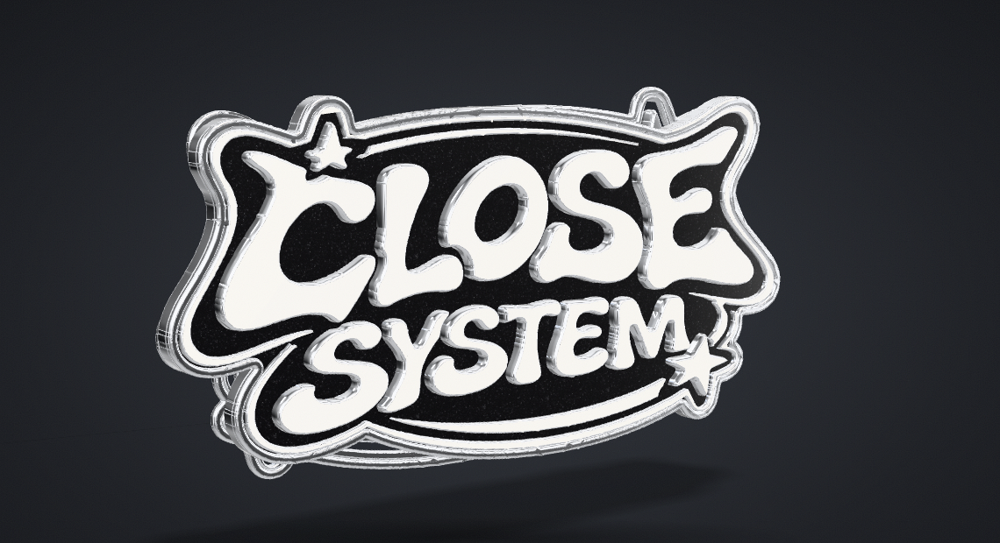

# Logo 3D Close System · three.js

Logotipo de Close System en relieve, con **acabado de metal cromado**, que flota y gira sobre un estudio oscuro. Se puede arrastrar con el dedo o el mouse.



- **Cromo:** la placa, la orilla y el bisel alrededor de cada letra, estrella y anillo son de metal pulido (`metalness 1`, rugosidad con micro-variación). Un entorno de estudio con tiras de luz le da reflejos largos.
- **Esmalte blanco:** las tapas de las letras, estrellas y anillos, con capa brillante (clearcoat).
- **Campo negro con destellos:** igual que el fondo del logo original.
- **Dos caras:** el logo se lee igual por el frente y por detrás (`data-caras="2"`). Con `data-caras="1"` el reverso queda como placa cromada lisa.
- **Interacción:** arrastrar con inercia y botones Girando/Pausa, Frente y Perfil. Se pausa cuando sale de la pantalla o la pestaña se oculta, y respeta `prefers-reduced-motion`.

| Dato | Valor |
|---|---|
| Versión | v1 |
| Origen | Motor derivado de [`modulo-3d-three-proplus-ciclo`](../../../disenos/modulos-threejs/modulo-3d-three-proplus-ciclo/) v1, del que conserva el estudio, las luces, la sombra y la interacción (el original no se modificó) |
| Motor | `motor/logo-three.js` (fuente) → `motor/logo-three.min.js` (three.js r187 incluido, sin CDN) |
| Medidas | 12 cm de ancho × 6.2 cm de alto; placa de 3.2 mm; letras 2.2 mm sobre la placa |

## Archivos
```
render-3d-logo/
├── motor/
│   ├── logo-three.js        ← fuente (ES module, importa three)
│   ├── logo-three.min.js    ← paquete listo para usar (incluye three.js)
│   └── logo-three.css       ← título, botones y estudio
├── plantilla/
│   ├── index.html           ← [EDITAR] atributos data-*
│   └── close-system-logo.svg← logo por capas
├── herramientas/
│   └── vectorizar-logo.py   ← PNG del logo → SVG por capas
└── vista-previa.png
```

## Cómo usarlo
1. Copia `plantilla/` a una carpeta nueva y ajusta la ruta a `../motor/` si la moviste.
2. En `index.html` cambia lo que necesites:

| Atributo | Para qué | Por defecto |
|---|---|---|
| `data-svg` | SVG por capas | `close-system-logo.svg` |
| `data-ancho` | ancho real del logo en cm | `12` |
| `data-grosor` | grosor de la placa en cm | `0.32` |
| `data-caras` | `2` logo en ambas caras · `1` reverso cromado liso | `2` |
| `data-velocidad` | grados por segundo | `30` |
| `data-titulo`, `data-subtitulo` | texto bajo el logo (vacío = sin texto) | — |
| `data-controles` | `no` oculta los botones | `si` |

**Desde JavaScript:** `LogoThree.montar(el, { svg: "...", titulo: "", controles: "no" })`. El elemento expone `el.l3t.pose(grados)` para dejarlo fijo en un ángulo (útil para capturas).

## Cómo está hecho el SVG por capas
`herramientas/vectorizar-logo.py` toma el PNG con fondo transparente y genera estas capas (atributo `data-capa`):

| Capa | Qué es | En 3D |
|---|---|---|
| `base` | silueta completa | placa cromada con el campo negro al frente |
| `borde` | orilla de la silueta | relieve cromado |
| `bandas` | anillos y trazos curvos | esmalte blanco con canto cromado |
| `letras` | letras y estrellas, 6 px más delgadas (invisible en el plano) | esmalte blanco con bisel cromado que crece hacia afuera hasta el contorno real |

`letras-dibujo` es el contorno real de las letras y solo sirve para ver el logo plano.

```
pip install opencv-python numpy pillow
python3 herramientas/vectorizar-logo.py ../../logos/close-system-logo-original.png plantilla/close-system-logo.svg --mapa mapa.png
```
Con `--mapa` guarda una imagen con cada pieza numerada: azul = bandas, amarillo = letras y estrellas.

**Por qué el bisel de las letras crece hacia afuera:** si el bisel se recorta hacia adentro, en las esquinas interiores muy cerradas (el pie de la L, las muescas de la S) el contorno se cruza consigo mismo y aparecen triángulos rotos. Por eso el adelgazado se hace en la imagen, que nunca se cruza, y el bisel solo crece.

## Volver a generar el motor
```
npm install three@0.187 esbuild
npx esbuild motor/logo-three.js --bundle --minify --format=iife --outfile=motor/logo-three.min.js
```

## Verificación (v1)
- **Probado** en Chrome sin pantalla (SwiftShader) a 1280 × 800, 1600 × 1000 y 390 × 844: sin errores ni avisos en la consola y sin desborde horizontal.
- **Revisado de cerca** a 0°, 35°, 70° y 180°: letras sin triángulos rotos, S y E sin excesos en las puntas, separación entre letras como en el original.
- **Pendiente:** medir los cuadros por segundo en un teléfono real.
