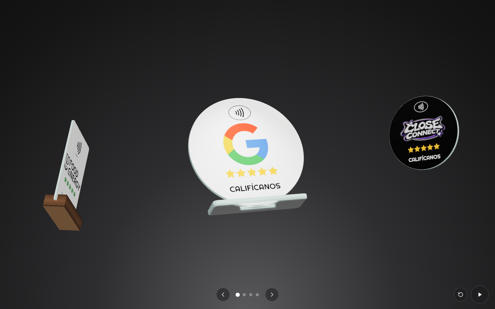

# Carrusel 3D de módulos Close Connect · three.js

Carrusel 3D en bucle infinito con los 4 módulos de Close Connect: **Pro → Pro Plus → Personal → Estándar → Pro…**. Cada módulo flota, gira sobre su eje y cambia de diseño en cada giro. El módulo del centro se puede girar con la mano y todo el carrusel se puede arrastrar. Cuando un módulo sale por un lado y entra por el otro, regresa con diseños nuevos.



| Dato | Valor |
|---|---|
| Versión | v1 |
| Origen | Reconstrucción del *floating can carousel* (prompt de thepromptsfactory). Los módulos son una copia adaptada de [`modulo-3d-three-*`](../) (los originales no se modificaron). |
| Motor | `motor/carrusel.js` + `motor/piezas.js` (fuente) → `motor/carrusel.min.js` (incluye three.js r187, sin CDN) |
| Plantilla | Trae los diseños de ejemplo de Close Connect: 10 Pro, 10 Pro Plus, 12 Personal y 10 Estándar |

## Qué hace
- **Entrada de 4.5 s:** aparece un módulo, la cámara se aleja, sube la luz y los demás se acomodan en ola.
- **Carrusel en bucle:** solo hay 4 módulos en escena, en orden fijo y sin fin hacia los dos lados. Se ven 3 a la vez; el cuarto espera fuera de cuadro, así que nunca se ve el brinco de un lado a otro.
- **Navegación:**
  - Arrastre con inercia y lanzamiento (si sueltas rápido, sigue de largo y se acomoda).
  - Rueda del ratón (un paso cada 280 ms; el zoom con pellizco del navegador sigue funcionando).
  - Flechas ← →, botones ‹ › y clic en un módulo vecino.
  - 4 puntos, uno por modelo, que llevan a cada uno por el camino más corto.
- **Funciones de cada módulo:**
  - Flota.
  - Gira sobre su eje a 34°/s.
  - La cara que queda de espaldas cambia al siguiente diseño.
  - El del centro se gira arrastrándolo y sigue girando con inercia.
  - Se inclina un poco hacia donde mueves el ratón.
- **Luz de estudio:**
  - Entorno HDR, dos focos y contraluz.
  - El vinil es satinado: brilla sin quemar los diseños blancos (medido: el blanco más fuerte llega a 241 de 255).
  - El acrílico tiene refracción real y el canto es pulido.
- **Controles:** Pausa congela todo (también la entrada) y Repetir vuelve a hacer la entrada sin recargar.
- **Accesibilidad:**
  - Anuncia el modelo seleccionado.
  - Los botones tienen nombre, estado y aro de foco.
  - Con *reducir movimiento* activado empieza en pausa y sin entrada; con ▶ se anima si la persona lo pide.
- **Rendimiento:**
  - Se detiene si no está en pantalla o si la pestaña está oculta.
  - La densidad de píxeles se limita a 1.5 y la refracción se calcula al 60 %.
  - `desmontar()` libera texturas, materiales, geometrías y el renderizador.

## Cómo usar tus diseños
1. Copia la carpeta `plantilla/` a donde la vayas a usar (junto con `motor/`, o cambia las rutas `../motor/`).
2. Prepara cada imagen con las herramientas de los diseños CSS (comandos desde la carpeta `carrusel-3d-modulos/`):
   - **Pro y Pro Plus** (disco, imagen cuadrada):
     `python3 ../../modulos-css/modulo-3d-pro-ciclo/herramientas/preparar-cara.py DISENO.png plantilla/caras/pro/mi-diseno.webp`
   - **Personal** (horizontal 8.5:5.4):
     `python3 ../../modulos-css/modulo-3d-personal/herramientas/preparar-tarjeta.py DISENO.png plantilla/caras/personal/mi-diseno.webp --vinil negro`
   - **Estándar** (vertical 5.4:8.5):
     `python3 ../../modulos-css/modulo-3d-estandar/herramientas/preparar-tarjeta.py DISENO.png plantilla/caras/estandar/mi-diseno.webp --vinil negro --orientacion vertical`
3. Sube las imágenes a `plantilla/caras/<modelo>/`.
4. En `plantilla/index.html`, edita la lista `[EDITAR]` (`<script id="cc-disenos">`). Escribe tus archivos en el orden en que quieres que salgan:
   ```json
   {
     "pro":      ["caras/pro/mi-diseno-1.webp", "caras/pro/mi-diseno-2.webp", "caras/pro/mi-diseno-3.webp"],
     "proplus":  ["caras/proplus/..."],
     "personal": ["caras/personal/..."],
     "estandar": ["caras/estandar/..."]
   }
   ```
   - Mínimo **1 diseño por modelo**. Con 1, ese módulo lleva el mismo diseño en las dos caras.
   - Con 2, uno al frente y otro atrás.
   - Con 3 o más, cada giro y cada vuelta del carrusel trae el siguiente.
   - Si falta un modelo o una imagen no carga, en pantalla aparece cuál.
5. Las imágenes van en WebP (lado mayor ~900 px). Pro y Pro Plus son cuadradas con el disco completo. Personal y Estándar ya llevan el color del vinil, igual que en los diseños CSS.

**Desde JavaScript (opcional):** `CCCarrusel.montar(seccion, { disenos: { pro: [...], proplus: [...], personal: [...], estandar: [...] } })`. Devuelve `estado()`, `mover(n)`, `irATipo("pro")`, `repetir()` y `desmontar()`.

## Archivos
```
carrusel-3d-modulos/
├── motor/
│   ├── carrusel.js       ← carrusel: entrada, ola, bucle, navegación, luz
│   ├── piezas.js         ← los 4 módulos: medidas, acrílico, vinil, bases
│   ├── carrusel.min.js   ← paquete listo para usar (incluye three.js)
│   └── carrusel.css      ← escenario carbón y controles
├── plantilla/
│   ├── index.html        ← [EDITAR] lista de diseños
│   └── caras/{pro,proplus,personal,estandar}/
└── vista-previa.png
```

## Volver a generar el motor
Solo si cambias `carrusel.js` o `piezas.js`:
```
npm install three esbuild
npx esbuild motor/carrusel.js --bundle --minify --format=iife --outfile=motor/carrusel.min.js
```
No cambies el motor para un proyecto; si lo mejoras para todos, sube la versión en este README.

## Diferencias con el prompt original
- No se pudo descargar el kit de Celsius, así que no hay latas, `studio.hdr` ni `metal.avif`. La luz de estudio usa `RoomEnvironment` de three.js.
- Son 4 módulos en bucle en vez de 24 latas, y 4 puntos (uno por modelo) en vez de 6. La separación se calcula según el ancho de pantalla para que el salto del bucle siempre ocurra fuera de cuadro; la forma de la ola se conserva.
- Exposición 0.82 y focos al 34 % de la intensidad original, para que los diseños blancos no se saturen.
- El fondo carbón se dibuja dentro de la escena, porque el acrílico necesita verlo para refractarlo.
- No se aplica el giro lateral de las latas (`rotation.z`), porque ladearía los módulos.

## Verificación (v1)
Probado en Chrome sin pantalla (SwiftShader) a 1440, 820 y 390 px, y el bucle de 390 a 2560 px:
- Flechas, botones, puntos, rueda, arrastre del carrusel y giro del módulo central.
- Pausa, Repetir, movimiento reducido y bucle (más de dos vueltas con diseños nuevos).
- Sin errores de consola, sin desborde y sin conexiones externas.
- Sin blancos quemados en los 4 modelos a 5 ángulos.

Pendiente: medir los cuadros por segundo en un teléfono real.
