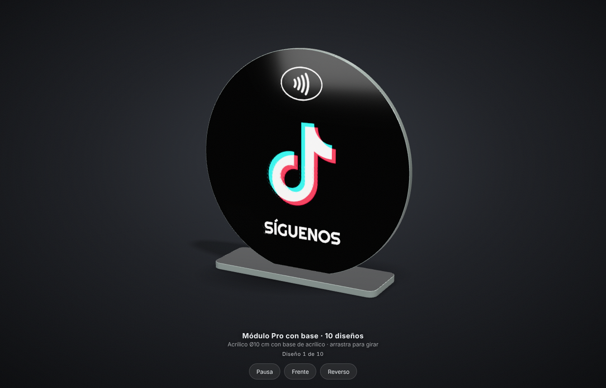

# Módulo 3D Pro con base · three.js

Versión fotorrealista del [`modulo-3d-pro-ciclo`](../../modulos-css/modulo-3d-pro-ciclo/) hecha con **three.js**. Disco de acrílico Ø10 cm × 3 mm con vinil en ambas caras, encajado en una base de acrílico 8 × 2.5 × 0.3 cm con ranura pasante de 3 cm. Entra 2.3 mm y queda a 0.7 mm de la mesa.



- **Acrílico real:** `MeshPhysicalMaterial` con transmisión, IOR 1.49, cantos pulidos con bisel y un ligero tinte verde-azulado.
- **Iluminación de estudio:** entorno HDR (`RoomEnvironment`), luz principal con sombras suaves (VSM), dos contraluces para los cantos y un softbox que barre un reflejo sobre el laminado al girar. Tone mapping *Neutral* para respetar los colores del diseño.
- **Texturas:** vinil satinado con laminado brillante (rugosidad con micro-variación).
- **Ciclo:** frente = diseño 1, reverso = diseño 2, luego 3, 4… El cambio ocurre de espaldas, así que nunca se ve. Abajo del título dice «Diseño N de M».
- **Interacción:** arrastrar con inercia, botones Girando/Pausa, Frente y Reverso. Se pausa fuera de pantalla y respeta `prefers-reduced-motion`.

| Dato | Valor |
|---|---|
| Versión | v1 |
| Origen | Derivado de [`modulo-3d-pro-ciclo`](../../modulos-css/modulo-3d-pro-ciclo/) v1 (el original no se modificó) |
| Motor | `motor/modulo-three.js` (fuente) → `motor/modulo-three.min.js` (three.js r187 incluido, sin CDN) |
| Modelo | `data-modelo="pro"` |
| Plantilla | Trae los diseños de ejemplo de Close Connect (cara-01 … cara-10) |

## Archivos
```
modulo-3d-three-pro-ciclo/
├── motor/
│   ├── modulo-three.js       ← fuente (ES module, importa three)
│   ├── modulo-three.min.js   ← paquete listo para usar (incluye three.js)
│   └── modulo-three.css      ← estilos del título, contador y botones
├── plantilla/
│   ├── index.html            ← [EDITAR] data-caras
│   └── caras/                ← cara-01 … cara-10
└── vista-previa.png
```

## Cómo usarlo
1. Copia `plantilla/` a una carpeta nueva.
2. Prepara cada diseño con la herramienta del diseño CSS original (`../../modulos-css/modulo-3d-pro-ciclo/herramientas/`).
3. Pon la lista en `data-caras` (mínimo 3) en `index.html`.

**Desde JavaScript:** `ModuloThree.montar(el, { modelo: "pro", caras: [...], titulo: "", controles: "no" })`. El elemento expone `el.m3t.lista()`, `el.m3t.estadoCiclo()` y `el.m3t.pose(grados)`.

## Volver a generar el motor
```
npm install three esbuild
npx esbuild motor/modulo-three.js --bundle --minify --format=iife --outfile=motor/modulo-three.min.js
```
El mismo motor sirve para los 4 modelos (`pro`, `proplus`, `personal`, `estandar`); si lo mejoras, cópialo a los 4 diseños y sube la versión.

## Verificación (v1)
- Chrome sin pantalla (SwiftShader) a 1280 y 390 px: sin errores de consola y sin desborde horizontal.
- El ciclo cambia la imagen: tras una vuelta pasa de los diseños 1/2 a 3/4.
- Pendiente: medir cuadros por segundo en un teléfono real.
